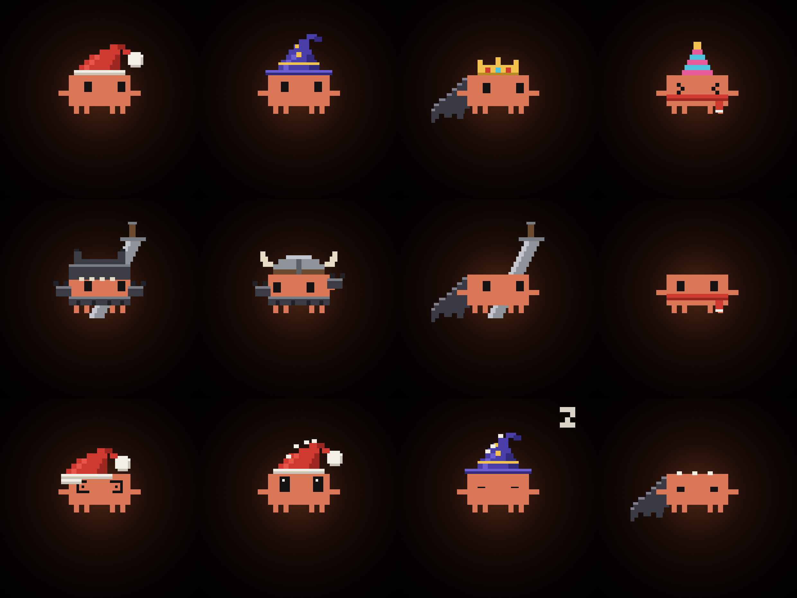

# clawd-wallpaper

A tiny pixel Claude Code mascot in a Santa hat who lives on your Mac desktop, under your icons and windows. Leave him on screen for a few seconds and he changes: he hauls in a giant sword and ends up in Berserker armour, and later on he's Iron Man, Doctor Manhattan, a Roman senator, and more. Click the moon and the Berserker change starts right away. It was made as a funny contrast to a very serious Berserk wallpaper.



macOS can't animate a still wallpaper, so this is a small native app that draws only the mascot in a transparent desktop-level window. Your wallpaper stays as it is.

## Build and run

Needs macOS and the Xcode command line tools.

```sh
./build.sh --install
```

This builds `ClawdWallpaper.app`, copies it to `/Applications` and opens it. On first launch he adds himself to your login items, so he keeps running after you close the terminal and comes back after a restart. You can see him in System Settings → General → Login Items.

- Stop him for now: `pkill ClawdWallpaper`
- Stop him opening at login: `/Applications/ClawdWallpaper.app/Contents/MacOS/ClawdWallpaper --no-login`, or switch him off in Login Items

Only one copy runs at a time. The options below work on the binary inside the app, for example `/Applications/ClawdWallpaper.app/Contents/MacOS/ClawdWallpaper --look king &`. At login he always starts with the default rotation.

## His looks

He normally wears the Santa hat. A new look starts every 50 seconds, so he's almost always dressed up: about 42 seconds in the look, then about 8 going back to Santa and waiting for the next one. The Berserker gets 40 seconds longer, because the sword takes a while. If your windows cover him for more than 20 seconds, he's back in the Santa hat and the next look comes 8 seconds after you uncover him.

| Look | What he wears |
| --- | --- |
| `berserker` | Wolf helm, armour, cape, and a sword on his back |
| `king` | Crown, red robe, scepter |
| `wizard` | Wizard hat, staff |
| `viking` | Horned helmet, axe, scarf |
| `party` | Party hat, scarf |
| `ironman` | Red and gold armour, arc reactor, thrusters |
| `manhattan` | Glowing blue, with a hydrogen atom on his forehead |
| `spiderman` | Web mask and the red and blue suit |
| `senator` | Laurel wreath, toga with a purple stripe, a very long speech |
| `samurai` | Kabuto helmet, lacquered armour, sheathed sword |
| `astronaut` | White suit, visor, air pack |
| `plague` | Plague doctor: beak, wide hat, cane |
| `pirate` | Tricorn, eyepatch, cutlass |

To change the rotation:

```sh
ClawdWallpaper --every 5                 # 5 minutes as Santa between looks
ClawdWallpaper --cycle berserker,king    # only these looks
ClawdWallpaper --look king               # always the king, no changes
```

Or build your own outfit, which also stops the rotation:

```sh
ClawdWallpaper --hat santa --wear none        # Santa only
ClawdWallpaper --hat crown --wear cape,sword  # mix and match
ClawdWallpaper --hat laurel --suit manhattan  # a blue senator
ClawdWallpaper --list                         # show every option
```

| Option | Choices |
| --- | --- |
| `--hat` | `santa`, `wizard`, `crown`, `party`, `viking`, `helm`, `ironhelm`, `laurel`, `kabuto`, `bubble`, `beak`, `tricorn`, `none` |
| `--wear` | `none`, or any comma-separated mix of `cape`, `robe`, `armor`, `scarf`, `sword`, `scepter`, `staff`, `axe` |
| `--suit` | `none`, `ironman`, `manhattan`, `spider`, `toga`, `samurai`, `astronaut`, `plague`, `pirate` |

### Add your own

To add a look, add an entry to `looks` in `main.swift` with its outfit and status lines. To add a new item, add a case to `Hat`, `Gear` or `Suit`, then draw it in `drawHat`, `drawSprite` or `drawSuit` using sprite pixels. The Swift compiler points at anything you've missed.

## What he does

**The Berserker change**

He wanders off the left edge and comes back dragging a giant sword flat behind him, hilt in hand, and keeps hauling until all of it is on screen. He lifts it 1 pixel, falls over and looks to Guts for approval, which doesn't come. So he reads the Armor's terms, the helm drops on and the armour clamps shut. Now the sword weighs nothing: he swings it, slams it down, and somehow fits it on his back, then walks home.

The other looks are quicker: his hat flies off, the new one drops on, and sparks fly.

**Most of the time**
- His eyes follow your cursor. Leave it alone for 10 seconds and he looks at the moon or at Guts instead.
- He blinks, bobs, tippy-taps his feet, and sometimes waves at Guts. Guts never waves back.
- A Claude Code-style status line sits under him, and each look has its own, such as `✻ Compacting 200 years of trauma… (esc to interrupt)`.

**When you interact**
- Click the moon and it turns blood red. He stares at it, then goes straight for the sword, whatever he was doing, and the moon stays red until the change is finished. The normal rotation carries on afterwards. A window over the moon blocks the click, and a fixed outfit (`--look`, `--hat`, `--suit`) ignores it.
- Hover over him for `> <` eyes and an excited wiggle.
- Click near him and he flinches. Click on him and he hops.
- Circle the cursor around him and he gets pulled along, then ends up dizzy with spiral eyes.

**Now and then**
- **The Eclipse:** very rarely, the moon goes dark with a red ring. He panics, then acts like nothing happened.
- **Sleep:** he dozes off if you're away for 5 minutes, or 1 minute late at night, and jolts awake when you move the mouse.
- **Low battery:** under 10% he gets visibly tired and runs on fumes.

To see a scene right away, starting 3 seconds after launch:

```sh
ClawdWallpaper --demo moon        # also any look's name, eclipse, sleep, dizzy, battery, click
```

Demo mode keeps him animating even when he's covered, so restart him normally afterwards.

## Performance

He's built to cost almost nothing:

- He pauses completely while your windows cover him or the display is asleep.
- Art is drawn at low resolution and scaled by the GPU, and nothing redraws unless it changed.
- The update rate drops when nothing is happening, and further when he's asleep or in Low Power Mode.
- The sword, flying hats, sparks, the blood moon and the Eclipse only exist while they're on screen.

Measured on an M4 MacBook Air, for the app's own process only, not including the work macOS does to draw it to the screen:

| State | CPU | Memory |
| --- | --- | --- |
| Covered by windows | under 0.1% | 10 MB |
| Visible, idle | about 0.2% | 10 MB |
| Sword scene | about 0.3% | 10 MB |

Clicks are noticed with a system mouse monitor that only uses the click's position. It doesn't see keystrokes, and nothing is recorded or sent anywhere. A click on the moon also checks whether an app window is covering that spot, using window positions only, not their names or contents.

## Using your own wallpaper

No wallpaper is included. The positions at the top of `main.swift` are fractions of the image, set up for one specific 16:9 picture:

- `anchorFrac`: where he floats
- `moonFrac`, `moonRadiusFrac`: the moon, for looking at, clicking on, and the Eclipse
- `gutsFrac`: what else he looks at
- `baseUnit`: his size

Live mode assumes the wallpaper uses the **Crop** placement (Fill Screen). The status lines are in the `verbs` array.

To bake him into a copy of an image instead, with no app running:

```sh
ClawdWallpaper --bake wallpaper.jpg wallpaper-clawd.jpg
```

Don't use a baked image as your wallpaper while the app is running, or you'll see two of him.

## Testing

```sh
ClawdWallpaper --selftest                       # every outfit and look through every scene
ClawdWallpaper --frames out/ wallpaper.jpg      # render each scene to a sheet of frames
ClawdWallpaper --sheet poses.png                # the image at the top of this page
```

## Credits

This is a fan project, not affiliated with or endorsed by Anthropic. Claude, Claude Code and the mascot belong to Anthropic, and Berserk belongs to Kentaro Miura and his publishers, Iron Man and Spider-Man to Marvel, and Doctor Manhattan to DC. The MIT license covers the code in this repo only.
